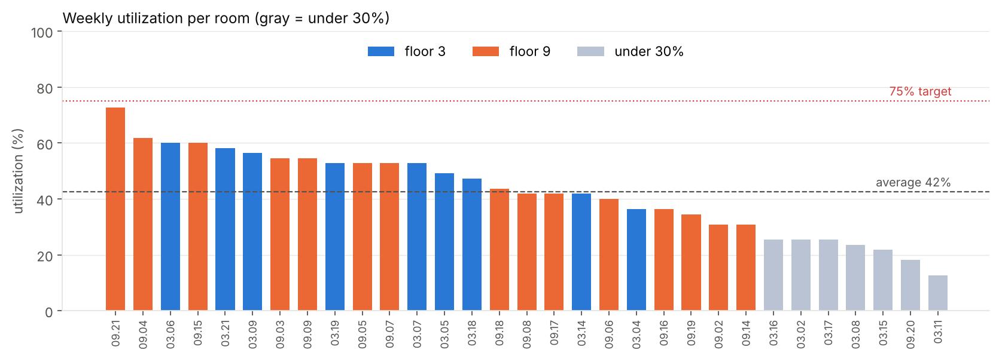
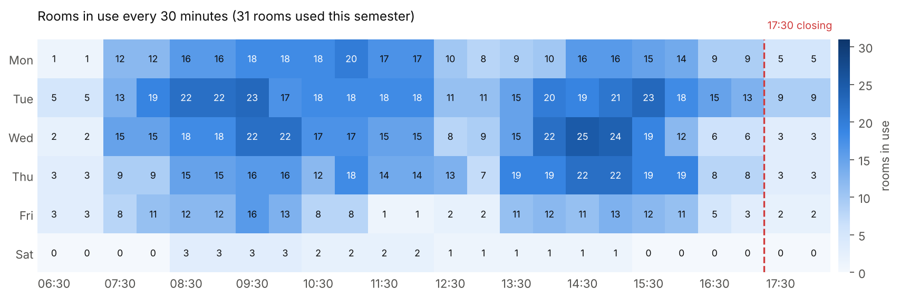
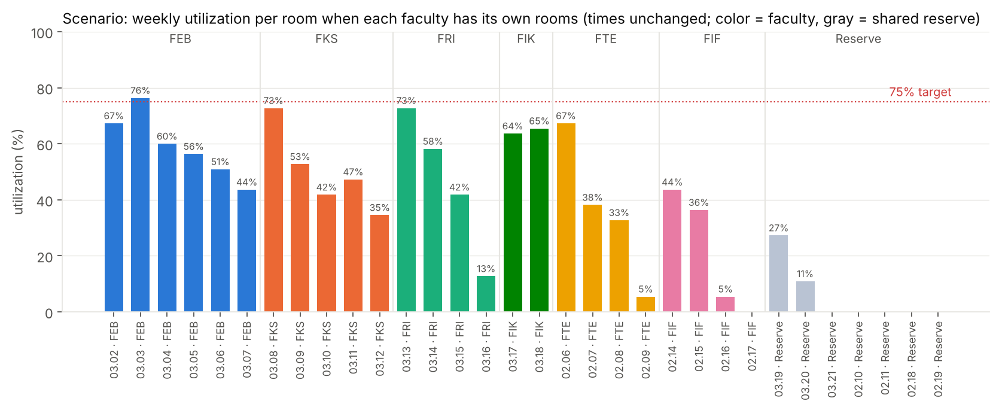
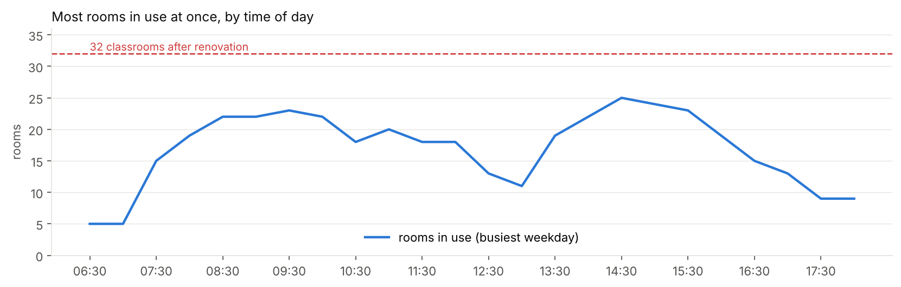
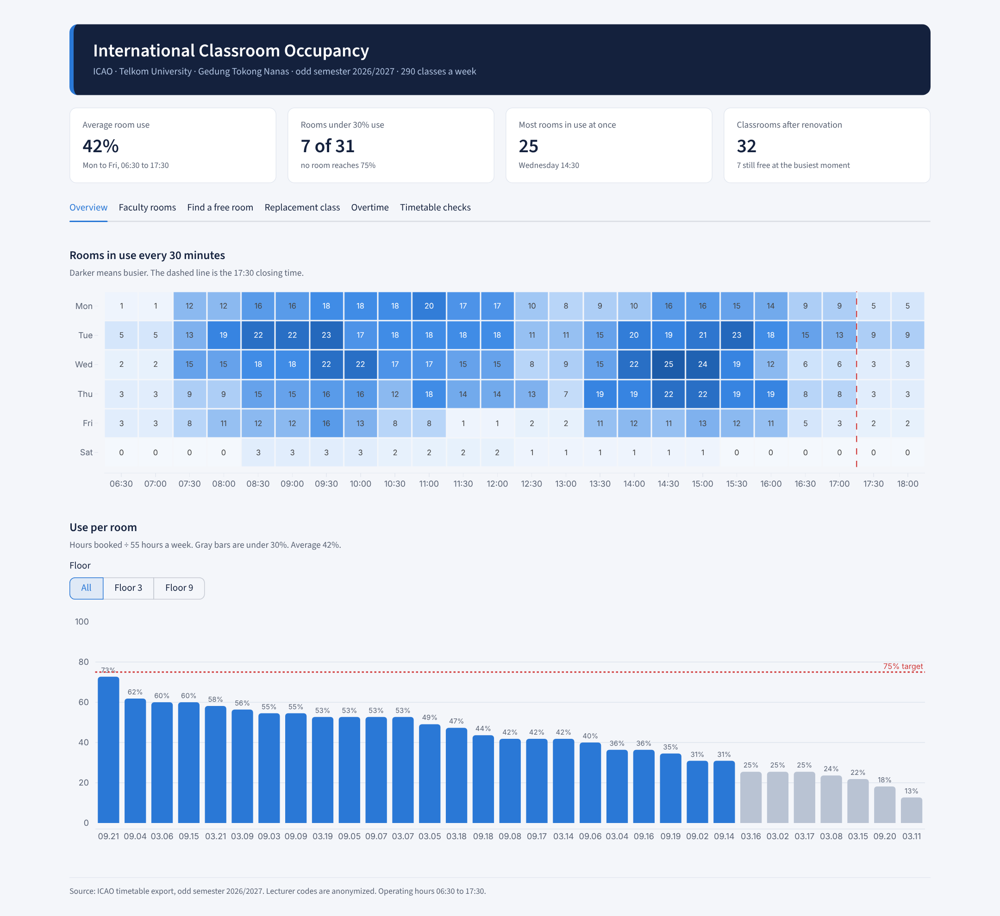
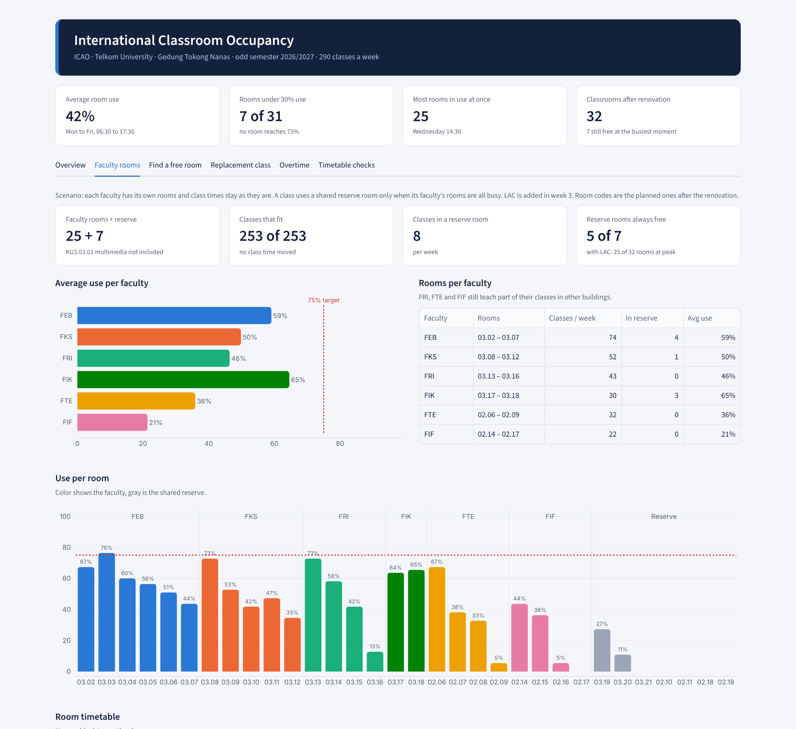
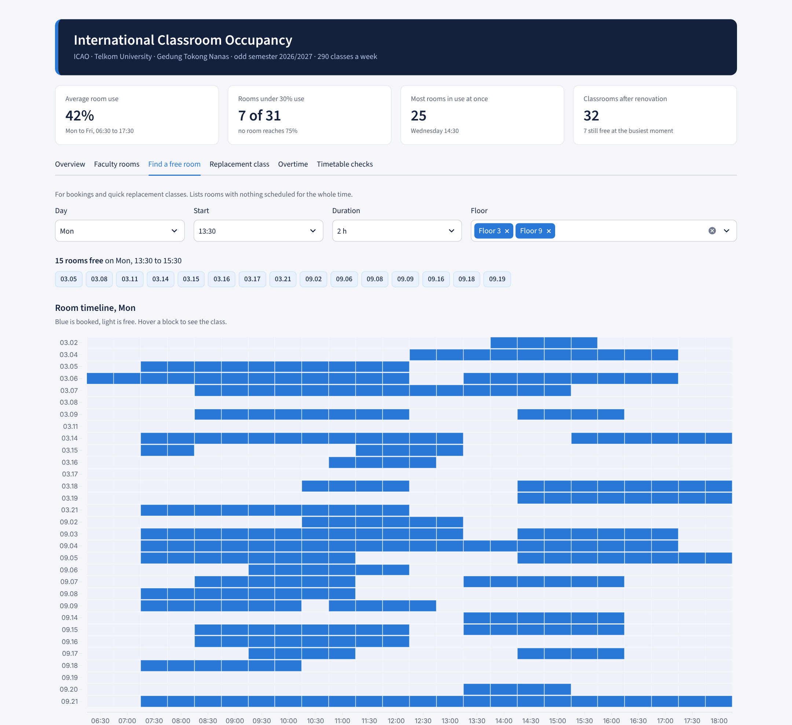
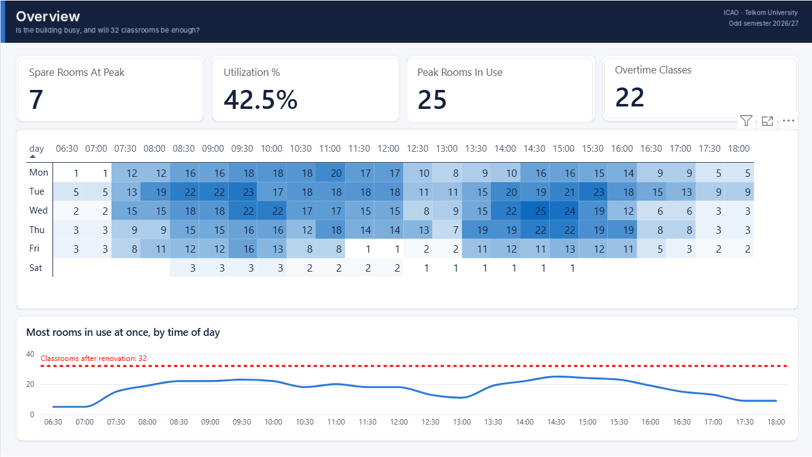

# Classroom occupancy: international class rooms

How the international classrooms at Gedung Tokong Nanas, Telkom University, are really used, and how they could be shared by faculty. Based on the real timetable for the odd semester 2026/2027 (290 weekly classes).

## Background

Before the renovation the international classes had 34 to 36 classrooms on floors 3 and 9. After it there will be **32**: 20 on floor 3 and 12 on floor 2. The International Class Academic Office (ICAO) noticed that many rooms sit unused, some for whole days, while others are always full. International student numbers are not expected to grow much in the next ten years.

The analysis answers three questions:
1. **How are the rooms used today?**
2. **What if each faculty gets its own rooms**, with class times left exactly as they are?
3. **Is 32 classrooms enough** after the renovation?

## Part 1. How the rooms are used today



- 290 classes a week use **31 rooms**, at an average of **42%** of operating hours (Mon to Fri, 06:30 to 17:30).
- **No room reaches 75%**, **7 rooms are under 30%**, and **13 rooms have at least one weekday with no class at all**.
- Use is uneven: from 73% (KU3.09.21) down to 13% (KU3.03.11).



- Two busy blocks every weekday, late morning and mid afternoon. Even at the busiest moment (Wednesday 14:30) only **25 rooms** are in use.

The building does not lack rooms. Every class takes whatever room is free, so 31 rooms each get a little use instead of fewer rooms being used well.

## Part 2. Scenario: rooms per faculty

Each faculty gets its own **home rooms**, and a class uses a **shared reserve room** only when all its faculty's rooms are busy. **No class time is moved.** LAC is not counted: its classes are scheduled in week 3 into whatever rooms are free.

Rooms use the planned codes after the renovation (still subject to change). Each faculty's rooms sit next to each other on one floor. KU3.03.01, the multimedia room, works on bookings and is not part of the plan.

| Faculty | Programs | Rooms | Codes | Classes / week | In a reserve room |
|---|---|---|---|---|---|
| FEB | International ICT Business, Accounting | 6 | KU3.03.02 to 03.07 | 74 | 4 |
| FKS | Business Administration, Communication | 5 | KU3.03.08 to 03.12 | 52 | 1 |
| FRI | Information Systems, Industrial Engineering | 4 | KU3.03.13 to 03.16 | 43 | 0 |
| FIK | Visual Communication Design | 2 | KU3.03.17 to 03.18 | 30 | 3 |
| FTE | Electrical Engineering, Telecommunication | 4 | KU3.02.06 to 02.09 | 32 | 0 |
| FIF | Informatics, Information Technology | 4 | KU3.02.14 to 02.17 | 22 | 0 |
| **Reserve** | shared | **7** | KU3.03.19 to 03.21, KU3.02.10, 02.11, 02.18, 02.19 | | |



- **All 253 classes fit** in their faculty's rooms or the reserve, **without moving any class time**.
- Only **8 classes a week** need a reserve room, and **at least 5 of the 7 reserve rooms are always free**.
- **LAC still fits** in week 3: with every class included, at most 25 of 32 rooms are in use at once.
- FRI, FTE and FIF still have classes in other buildings, so their home rooms have the most free hours, ready for those classes.

## Part 3. Is 32 enough?



Yes. At most 25 rooms are in use at the same moment, so 32 leaves 7 free even at the peak. Going from 34 or 36 rooms down to 32 is not a problem.

## Recommendations

1. **Go ahead with 32 classrooms.**
2. **Give each faculty fixed rooms** (FEB, FKS, FRI and FIK on floor 3; FTE and FIF on floor 2) and keep **7 rooms as a shared reserve** for overflow, LAC, replacement classes and bookings.
3. **Bring FRI, FTE and FIF classes from other buildings** into their home rooms.
4. **Review the overtime classes and flagged timetable entries** with the study programs (notebook appendix).
5. **Track use every semester.** The next step toward 75% per room is spreading class start times more evenly.

## Also in the analysis

- **Overtime:** 22 weekday classes end at 18:30. For 19 of them this timetable has a free slot one hour earlier (room, class group and lecturer free). These are options to confirm with study programs, not changes.
- **Timetable checks:** 3 entries to fix (a class group in two rooms at once, a class during Friday prayer, a Saturday class recorded at 20:30 to 23:30).

## Dashboard

`app.py` is a Streamlit dashboard for the office staff:

| Tab | What it does |
|---|---|
| Overview | Rooms in use every 30 minutes, and use per room |
| Faculty rooms | The scenario: use per faculty and per room, and a room timetable for each day |
| Find a free room | Pick a day, start time and duration: lists free rooms and shows a room-by-room timeline |
| Replacement class | Pick a class and course: lists every slot where a room, the class group and the lecturer are free |
| Overtime | Earlier candidate slots for classes ending after 17:30 |
| Timetable checks | Entries to check before the timetable is final |







## Power BI version

The same data as a star schema with DAX measures and a 5-page report (`powerbi/classroom-occupancy.pbix`). Model, measures and layout are in [`powerbi/README.md`](powerbi/README.md).




## How the analysis works

| Step | Method |
|---|---|
| Data cleaning | Columns renamed, days standardized, lecturer codes replaced with anonymous IDs (`scripts/prepare_data.py`) |
| Timetable checks | Any room, class group or lecturer booked twice at once, classes during Friday prayer, impossible hours |
| SQL | Classes per day and program, utilization per floor, plus window functions: `RANK` per floor, `ROW_NUMBER` for the busiest slot per day, overtime share per program, `LAG` for free gaps between classes (`sql/queries.sql`) |
| Utilization | Hours booked inside operating hours ÷ 55 hours |
| Busy hours | Rooms in use for every day and 30-minute slot |
| Faculty scenario | Each faculty's classes are placed day by day, in order of end time, into the home room that became free most recently; the rest go to the reserve the same way. This keeps the reserve as empty as possible. No class time changes |
| Overtime options | Same-day slots up to 2 hours earlier, ending by 17:30, with class group, lecturer and room free |

## Data and limits

The timetable comes from the office's timetable export and is used with permission. Lecturer codes are replaced with anonymous IDs (`L001`, ...), and the raw export is kept out of the repository (`data/raw/` is in `.gitignore`).

- Only one semester is analyzed: the renovation starts this semester, so this is the timetable it has to fit.
- The data only covers these rooms. Classes in other buildings, lecturer availability and meetings are not in it, so "free" means free **in this timetable**.
- LAC sets its own timetable in fixed packages and is scheduled in week 3, so it is left out of the faculty scenario and the timetable checks.
- The Saturday class at 20:30 to 23:30 is treated as a likely input error. Student counts were not in the export, so seat use is not analyzed.

## Project structure

```
├── app.py                        Streamlit dashboard
├── data/
│   ├── schedule.csv              cleaned timetable (290 classes)
│   └── rooms_current.csv         31 rooms in use
├── notebooks/
│   └── occupancy_analysis.ipynb  full analysis
├── scripts/
│   ├── prepare_data.py           cleans and anonymizes the raw export
│   ├── export_powerbi.py         exports the star schema for Power BI
│   └── occupancy.py              shared logic for notebook and dashboard
├── sql/
│   └── queries.sql
├── powerbi/
│   ├── classroom-occupancy.pbix  the Power BI report
│   ├── README.md                 data model, DAX measures, report pages
│   ├── data/                     star-schema CSVs
│   └── design/                   report theme and page backgrounds
└── images/
    ├── analysis/                 charts from the notebook
    ├── streamlit/                dashboard screenshots
    └── powerbi/                  Power BI report screenshots
```

## Run it

```bash
pip install -r requirements.txt

# dashboard
streamlit run app.py

# notebook
cd notebooks
jupyter notebook occupancy_analysis.ipynb
```

## Tools

Python (pandas, matplotlib, plotly) · SQL (SQLite, window functions) · Power BI (DAX) · Streamlit · Jupyter
