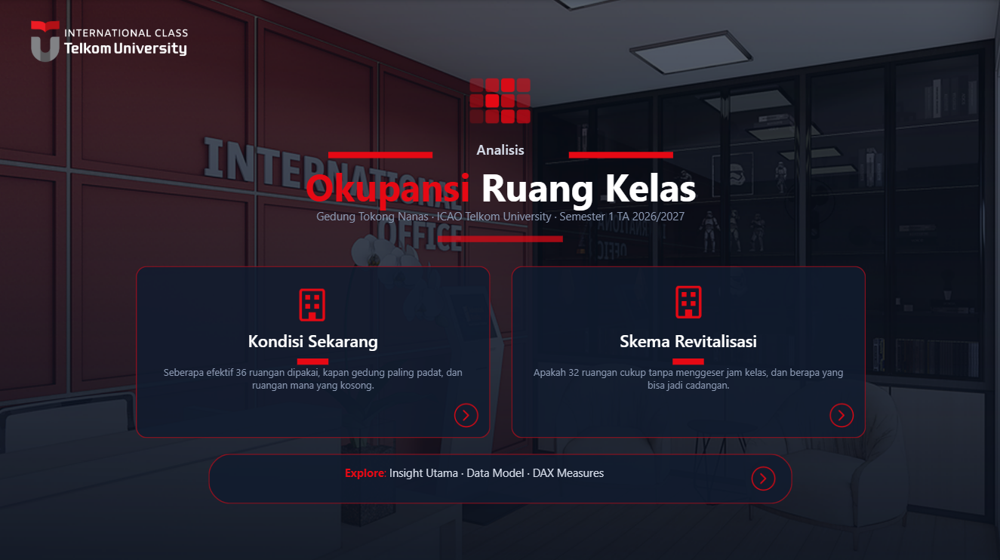
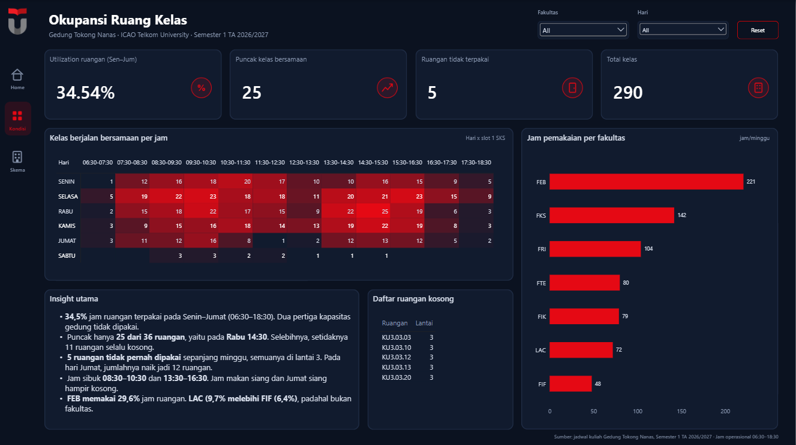
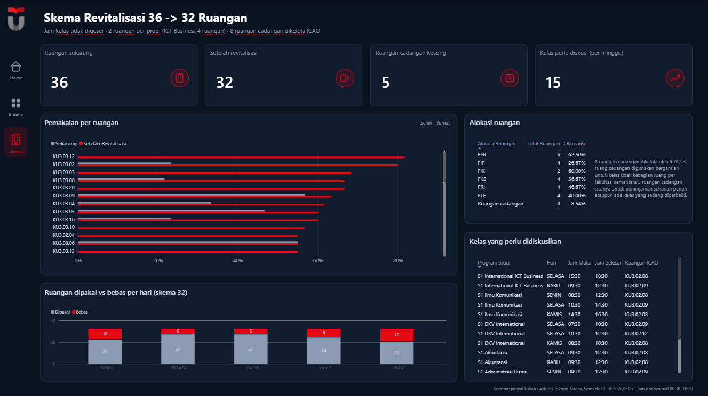
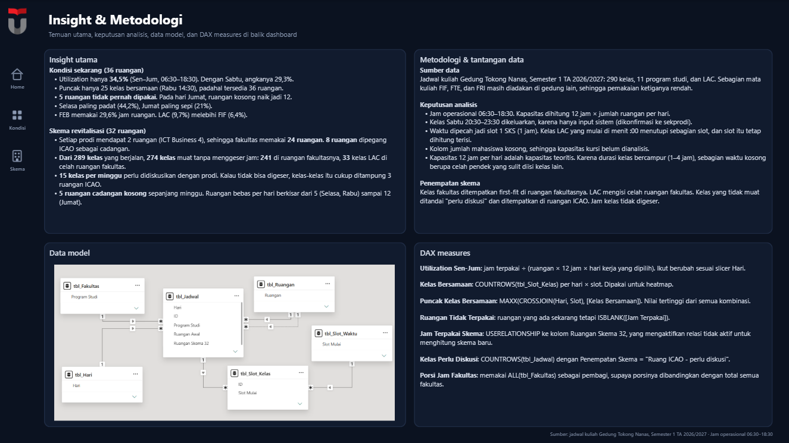
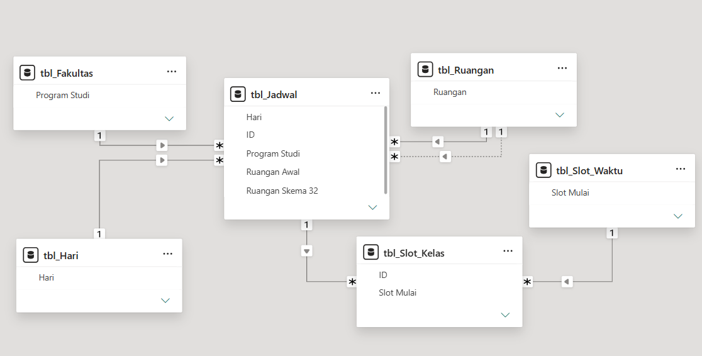

# Classroom Occupancy Analysis – ICAO Telkom University

Power BI dashboard I built to check how our classrooms are actually used, and to test a new way of assigning rooms before the building renovation.

## Why I made this

I work at ICAO (International Class Academic Office), Telkom University. Every semester we give rooms to each study program based on what they ask for. But during the semester I kept seeing rooms that were assigned but empty, while some programs still said they didn't have enough rooms.

This became a real problem because of the renovation. We're going from 36 rooms to 32, and my supervisor asked how we could use the rooms better and still keep some spare rooms for emergencies (broken facilities, full-day bookings, etc.).

So I took the class schedule for this semester and analyzed it. It was also my first time building a full dashboard in Power BI, so I learned DAX and data modeling along the way.

The data is the real schedule of Gedung Tokong Nanas, Semester 1 2026/2027 (290 classes). I'm using it with permission from ICAO, and lecturer names/IDs are removed.

## What I found

- Rooms are only used **34.5%** of the time (Mon–Fri, 06:30–18:30).
- At the busiest moment (Wednesday 14:30) only **25 classes run at the same time**, even though we have 36 rooms.
- **5 rooms are never used** at all. On Fridays, 12 rooms are empty.
- Giving rooms per study program wastes space. Each program has its busy hours at different times, so when you lock rooms per program you need **39 rooms** to cover every peak. Per faculty it's 36. If all rooms were shared, 25 would be enough.

## The scheme I proposed

For next semester we're trying a per-faculty setup:

- Each study program counts as **2 rooms** (ICT Business gets 4 because it has 2 classes per year), and the rooms are pooled per faculty. Total: **24 rooms** for faculties.
- The other **8 rooms** are kept by ICAO as reserve.

I simulated this with the current schedule without changing any class times:

- **274 of 289 classes** fit in their faculty's rooms (the Language Center classes fit in the gaps between faculty classes).
- **15 classes per week** don't fit during peak hours. For these, we'll talk with the program first and offer another time slot. If that doesn't work, they use an ICAO room.
- Even then, only 3 ICAO rooms are needed, so **5 rooms stay completely free** all week.

## How I did it

- Cleaned the schedule and split each day into 1-hour slots (1 SKS) to count how many classes run at the same time.
- Removed one Saturday 20:30–23:30 class. I asked the study program and it turned out to be just a placeholder in the system.
- Language Center classes start at :00 while others start at :30, so some slots are only half used. I still counted them as used, since no class can fit in 30 minutes.
- Used Python to prepare the tables and simulate the room placement, then built the model and visuals in Power BI.

A few limitations: some FIF, FTE and FRI courses are still held in another building, so their numbers here look lower than they really are. Student counts were empty in the data, so I couldn't check seat capacity. And the schedule changes every semester, so this needs to be re-run with each new schedule.

## Data model

Simple star schema with the class schedule (`tbl_Jadwal`) in the middle. The link between `tbl_Jadwal[Ruangan Skema 32]` and `tbl_Ruangan` is inactive and turned on with `USERELATIONSHIP` when calculating the new scheme.

## Files

- `Dashboard Okupansi.pbix` – the Power BI report
- `Data/Jadwal Semester 1 International Telkom University 2627.xlsx` – cleaned data used by the report
- `Images/` – page screenshots

To open it, install Power BI Desktop (free). If it can't find the data, go to Transform data → Data source settings, point it to the Excel file in `data/`, then Refresh.

**Tools:** Power BI (DAX, Power Query), Python (pandas), Excel

---

Muhammad Antarez Qhadafi · [LinkedIn](https://linkedin.com/in/antarezq) · [Portfolio](https://antarezq.github.io)
