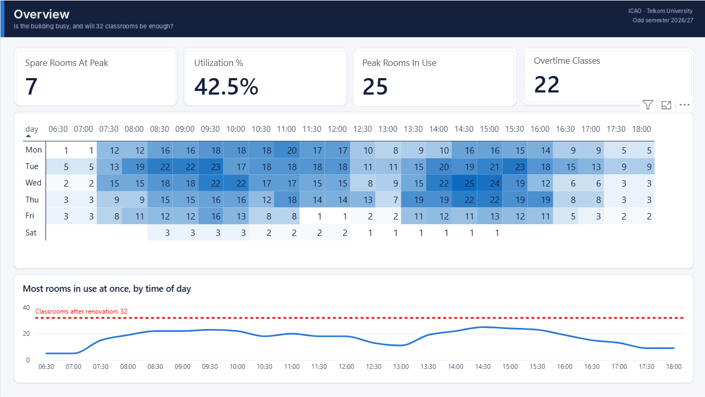
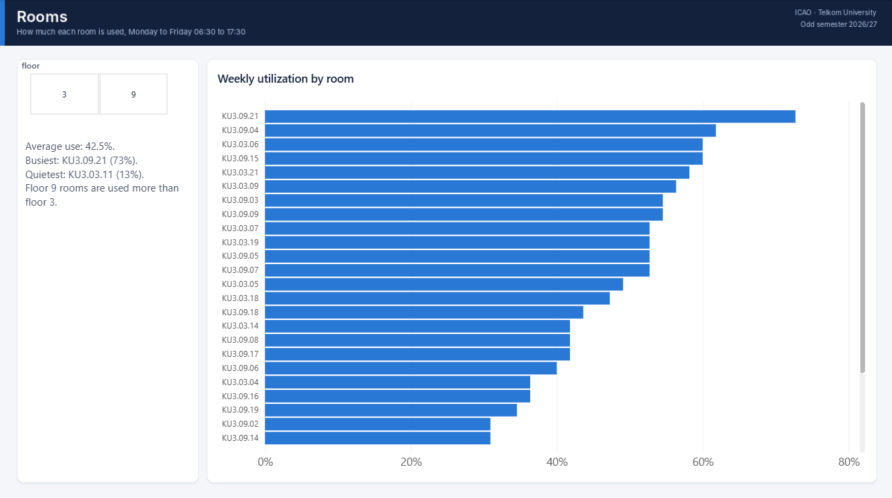
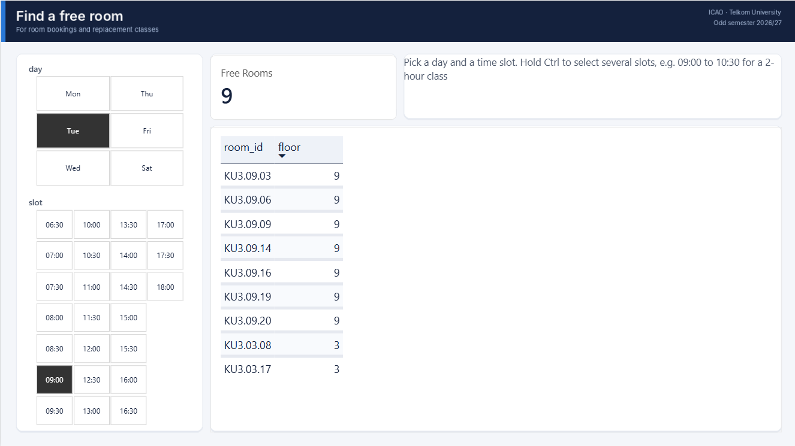
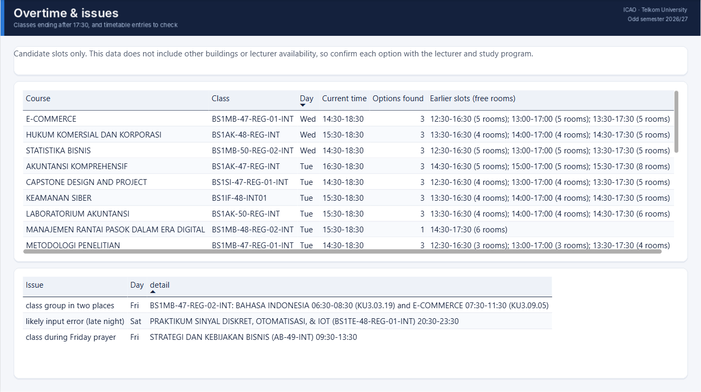
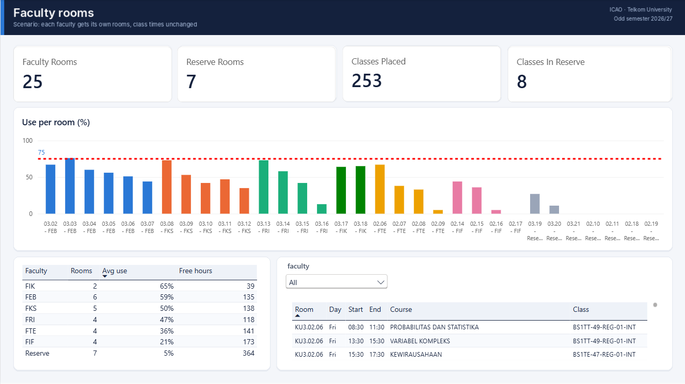

# Power BI version

The same analysis as a Power BI report. The data model is exported by `scripts/export_powerbi.py` into `powerbi/data/`.

## Data model (star schema)

```
                 dim_day ──┐
                           │
dim_room ── fact_room_slot ┼── dim_slot
    │                      │
    └────── fact_class ────┴── dim_class
```

| Table | Grain | Key columns |
|---|---|---|
| `fact_room_slot` | one room × day × 30-minute slot (4,464 rows) | `room_id`, `day`, `slot`, `occupied` (1/0), `course_name`, `class_group` |
| `fact_class` | one weekly class (290 rows) | `session_id`, `room_id`, `day`, `class_group`, `start_time`, `end_time`, `duration_hours`, `is_overtime` |
| `dim_room` | one room | `room_id`, `floor`, `capacity` |
| `dim_day` | Mon to Sat | `day`, `day_order`, `is_weekday` |
| `dim_slot` | 06:30 to 18:00 every 30 minutes | `slot`, `slot_order`, `in_operating_hours` |
| `dim_class` | one class group | `class_group`, `program` |
| `overtime_options`, `timetable_issues` | analysis results | shown as tables |
| `scenario_rooms` | one room in the faculty scenario (32 rows) | `room_order`, `room` (planned code), `label` (e.g. 03.06 - FEB), `group` (faculty or Reserve), `floor`, `booked_hours`, `free_hours`, `utilization_pct`, `color` |
| `scenario_plan` | one class in the faculty scenario (253 rows) | `session_id`, `faculty`, `new_room`, `uses_reserve` |

Relationships (single direction, dimension → fact):
- `dim_room[room_id]` → `fact_room_slot[room_id]` and `fact_class[room_id]`
- `dim_day[day]` → `fact_room_slot[day]` and `fact_class[day]`
- `dim_slot[slot]` → `fact_room_slot[slot]`
- `dim_class[class_group]` → `fact_class[class_group]`

Sort `dim_day[day]` by `day_order` and `dim_slot[slot]` by `slot_order` (Column tools → Sort by column).

## Measures (DAX)

```DAX
Classes = COUNTROWS ( fact_class )

Rooms In Use =
CALCULATE ( DISTINCTCOUNT ( fact_room_slot[room_id] ), fact_room_slot[occupied] = 1 )

Free Rooms =
DISTINCTCOUNT ( dim_room[room_id] ) - [Rooms In Use]

Utilization % =
VAR ops =
    CALCULATETABLE (
        fact_room_slot,
        dim_slot[in_operating_hours] = TRUE (),
        dim_day[is_weekday] = TRUE ()
    )
RETURN
    DIVIDE ( COUNTROWS ( FILTER ( ops, fact_room_slot[occupied] = 1 ) ), COUNTROWS ( ops ) )

Peak Rooms In Use =
MAXX (
    SUMMARIZE ( fact_room_slot, dim_day[day], dim_slot[slot] ),
    [Rooms In Use]
)

Rooms After Renovation = 32

Spare Rooms At Peak = [Rooms After Renovation] - [Peak Rooms In Use]

Overtime Classes =
CALCULATE ( [Classes], fact_class[is_overtime] = TRUE () )
```

Check: with no filters, `Utilization %` should show 42.5%, `Peak Rooms In Use` 25 and `Overtime Classes` 22, the same as the notebook.

## Look

`powerbi/design/` holds the report theme (`icao_theme.json`, View → Themes → Browse for themes) and one 1280×720 background per page (`bg_*.png`, Format page → Canvas background → Image, fit: Fit, transparency 0%). Visuals sit on the white panels with their own background turned off.

## Report pages

| | |
|---|---|
|  |  |
|  |  |
|  | |


1. **Overview**: cards for `Utilization %`, `Peak Rooms In Use`, `Spare Rooms At Peak`, `Overtime Classes`. A matrix with `dim_day[day]` on rows, `dim_slot[slot]` on columns and `Rooms In Use` as values, with a background color scale (Conditional formatting → Background color).
2. **Rooms**: a bar chart of `Utilization %` by `dim_room[room_id]`, colored by `floor`, with a floor slicer.
3. **Find a free room**: a day slicer, then a matrix with `dim_room[room_id]` on rows, `dim_slot[slot]` on columns and `Rooms In Use` as values (1 = booked). Color 1 blue and blank light, and add `course_name` to the tooltip.
4. **Overtime and issues**: the `overtime_options` and `timetable_issues` tables, with a note that options need confirmation from lecturers and study programs.
5. **Faculty rooms** (scenario). See the next section.

## Page 5: Faculty rooms

Uses `scenario_rooms` and `scenario_plan`. They need no relationships. Background: `design/bg_faculty.png`.

Set the data types in Power Query first: `utilization_pct`, `booked_hours`, `free_hours` and `floor` as Whole Number, `uses_reserve` as True/False.

```DAX
Faculty Rooms = CALCULATE ( COUNTROWS ( scenario_rooms ), scenario_rooms[group] <> "Reserve" )

Reserve Rooms = CALCULATE ( COUNTROWS ( scenario_rooms ), scenario_rooms[group] = "Reserve" )

Classes Placed = COUNTROWS ( scenario_plan )

Classes In Reserve = CALCULATE ( COUNTROWS ( scenario_plan ), scenario_plan[uses_reserve] = TRUE () )

Avg Room Use % = DIVIDE ( AVERAGE ( scenario_rooms[utilization_pct] ), 100 )
```

Check: `Faculty Rooms` 25, `Reserve Rooms` 7, `Classes Placed` 253, `Classes In Reserve` 8.

| Visual | Fields | X | Y | W | H |
|---|---|---|---|---|---|
| Card | Faculty Rooms | 24 | 88 | 296 | 104 |
| Card | Reserve Rooms | 332 | 88 | 296 | 104 |
| Card | Classes Placed | 640 | 88 | 296 | 104 |
| Card | Classes In Reserve | 948 | 88 | 308 | 104 |
| Clustered column chart | X: `scenario_rooms[label]`, Y: `utilization_pct` (Don't summarize), no legend; constant line at 75 | 24 | 204 | 1232 | 268 |
| Table | `group`, Count of `room`, `Avg Room Use %`, Sum of `free_hours` | 24 | 484 | 480 | 212 |
| Slicer (dropdown) + table | Slicer: `scenario_plan[faculty]`. Table: `new_room`, `day`, `start_time`, `end_time`, `course_name`, `class_group` | 516 | 484 | 740 | 212 |

Color the columns by faculty with the `color` column: Format → Columns → Color → **fx** → Format style **Field value** → Based on field **First color** of `scenario_rooms[color]`. The colors match the Streamlit dashboard. To keep the rooms grouped by faculty (as in the dashboard), go to Table view, select `scenario_rooms[label]` → Column tools → **Sort by column** → `room_order`, then sort the chart axis by `label` ascending.
